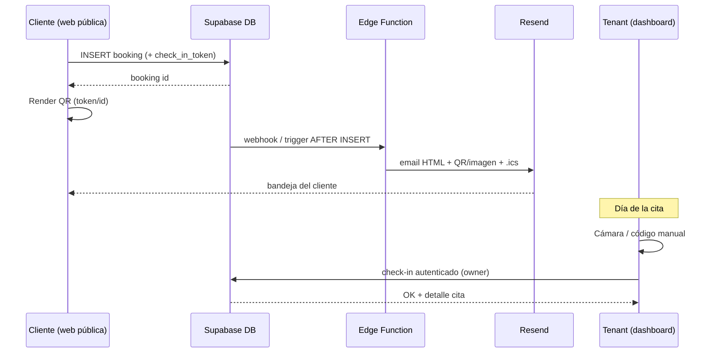

# Booking confirmation — storming

Documento de exploración (no es un plan de implementación). Fecha de contexto: octubre 2026.  
Stack actual: React + Vite + TypeScript, Supabase (Auth, Postgres, Storage, RLS), plan Free del proyecto `fastbook`.  
Estado hoy: al crear una reserva se hace `INSERT` en `bookings` y se muestra `BookingConfirmation`. El copy ya promete *“comprobante y acceso QR”* al email del cliente, pero **no hay email transaccional ni QR**. La agenda Stitch tenía “Validar QR” y se aplazó a propósito.

---

## Resumen ejecutivo

| Pregunta | Veredicto corto |
|---|---|
| 1. ¿Email de confirmación con lo actual + free? | **Sí, con un añadido mínimo:** Edge Function (incluida en Supabase Free) + proveedor externo (p. ej. Resend Free). **No** se puede hacer con el mailer de Supabase Auth. |
| 2. ¿QR en el último step? ¿En cliente? ¿En el email? | **Sí en cliente** (librería ligera, sin coste). **Sí en el email** (misma carga útil / imagen adjunta o embebida). |
| 3. ¿Cómo lee el tenant el QR? | **Desde nuestra web** (cámara del móvil en el dashboard). No hace falta app nativa. Fallback: código corto mecanografiado. |
| 4. ¿Tecnologías + costes si faltan piezas? | Cadena viable a **0 €** en MVP (Supabase Free + Resend Free + QR/scanner en browser). Coste real al escalar: Resend Pro (~20 $/mes) y, más adelante, Supabase Pro si el Free se queda corto. |
| 5. Otras estrategias | Enlace mágico / código corto / `.ics` / SMS-WhatsApp / check-in por nombre en agenda / PWA. |

**Recomendación de producto (MVP):**  
1) Email vía Edge Function + Resend.  
2) QR generado en cliente en el step 3 + mismo payload en el email.  
3) Validación en `/enterprise/:tenantSlug/…` con cámara web + entrada manual.  
Sin app nativa y sin cambiar de backend.

---

## Contexto del producto

Flujo reservador (`/:tenantSlug`): día → hora → servicio → datos → confirmación.

Datos relevantes en `bookings` hoy:

- `id` (uuid) — candidato natural a “código de reserva”
- `customer_email`, `customer_name`, `customer_phone`
- `status`: solo `confirmed` \| `cancelled` (no hay `checked_in` / `completed` persistido; la UI de agenda deriva estados por hora)

Implicación: para “confirmar llegada con QR” hace falta **al menos** un estado o timestamp de check-in en BBDD (p. ej. `checked_in_at` o `status = 'checked_in'`), además del email/QR.

`createBooking` hoy no devuelve el `id` insertado; para QR/email fiable conviene `insert().select('id').single()`.

---

## 1) ¿Enviamos email de confirmación? ¿Es posible con el stack y tiers free?

### Qué **no** sirve

Supabase Auth solo envía emails de **autenticación** (signup, recover, magic link, etc.).

- El SMTP built-in de Auth en Free: ~**2 emails/hora**, y en la práctica solo a emails del equipo del proyecto. No es un producto de email transaccional.
- Custom SMTP en Auth mejora los mails de Auth; **no** abre un endpoint genérico “manda este HTML a este cliente”.
- No se puede (ni se debe) enviar email de reserva desde el navegador con API keys: la clave quedaría pública.

Conclusión: **el mailer de Auth no resuelve confirmaciones de reserva**, aunque ya lo usemos para el alta enterprise.

### Qué **sí** funciona (patrón oficial Supabase)

Documentación oficial: [Sending Emails (Edge Functions + Resend)](https://supabase.com/docs/guides/functions/examples/send-emails).

```
Cliente reserva → INSERT bookings (RLS público)
       ↓
Edge Function (o Database Webhook / trigger → Function)
       ↓
API Resend (u otro ESP) → email al customer_email
```

Piezas:

| Pieza | ¿Ya la tenemos? | Tier free |
|---|---|---|
| Supabase Edge Functions | Disponible en el proyecto; aún no hay functions de producto en el repo | **500 000 invocaciones/mes** incluidas en Free |
| Proveedor de email (Resend) | No | Free: **3 000 emails/mes**, tope **100/día** |
| Dominio de envío verificado | No | Necesario en prod (DNS SPF/DKIM). En tests: `onboarding@resend.dev` |

Alternativas al ESP (mismas ideas, otros precios): Brevo, Postmark, Amazon SES, Mailgun. Resend encaja bien porque es el ejemplo canónico de Supabase y tiene free forever razonable para MVP.

### Disparadores posibles

1. **Tras `createBooking` en el FE:** `supabase.functions.invoke('send-booking-confirmation', { body: { bookingId } })`. Simple; riesgo: el cliente cierra la pestaña antes / fallos de red → email perdido si no hay reintento.
2. **Database Webhook / trigger `AFTER INSERT` en `bookings`:** más fiable (el email no depende del navegador). Requiere secretos y cuidado con RLS/service role.
3. **Cola + reintentos** (más adelante): si el volumen o la fiabilidad lo piden.

Para MVP: (2) es preferible; (1) vale como prototipo rápido.

### Límites free en la práctica (orden de magnitud)

- 100 emails/día Resend Free ≈ **~3 000 reservas/mes** con 1 email/reserva (sin recordatorios).
- Si además enviamos copia al tenant o un recordatorio D-1, se divide la cuota.
- Edge Functions Free (500k) no será el cuello de botella frente a Resend.

**Respuesta:** sí es viable en free **añadiendo** Edge Function + ESP. No es “cero trabajo”, pero no obliga a subir de plan Supabase ni a montar un backend aparte.

---

## 2) ¿Generamos QR en el último step? ¿En cliente? ¿En el email?

### Generación en cliente: sí

Totalmente viable en el SPA actual:

- Librerías típicas: `qrcode`, `qrcode.react`, etc. (canvas/SVG, sin servidor).
- Carga útil recomendada: **no** meter PII en el QR. Preferir:
  - URL profunda firmada o con token, p. ej.  
    `https://{host}/enterprise/{tenantSlug}/check-in/{bookingId}?t={token}`  
  - o un payload compacto: `{ bookingId, token }` / código corto derivado.
- El step 3 (`BookingConfirmation`) ya es el sitio natural: mostrar QR + “guárdalo / te lo enviamos por email”.

Coste: **0 €** (solo dependencia npm). Sin servicio SaaS de QR.

### QR en el email: sí

Opciones:

| Enfoque | Pros | Contras |
|---|---|---|
| A. Misma URL/código en el HTML del email + imagen QR generada en la Edge Function (o librería Deno) y adjunto/`img` | Cliente lo tiene offline en el móvil | Hay que generar PNG en servidor o hostear la imagen |
| B. Enlace “Ver mi reserva / mostrar QR” a una página pública autenticada por token | Un solo source of truth; QR siempre regenerable | Depende de abrir el link; peor si no hay red en el local |
| C. Adjuntar `.png` del QR vía Resend attachments | Muy claro para el usuario | Peso del mail; regenerar si cambia el token |

Recomendación MVP: **A + B** ligeros — email con resumen + imagen QR (o CID) **y** enlace “abrir comprobante” por si pierde la imagen. El cliente también ve el QR en el step 3 antes de cerrar.

### Seguridad del payload

- El `booking.id` solo **no** debería bastar para check-in público (adivinable/enumerable en teoría).
- Mejor: `check_in_token` (random opaco) guardado en `bookings`, o firma HMAC corta en la URL.
- Validación siempre **server-side** (RPC / Edge Function / update con policy de owner): el scanner del tenant llama a la API autenticado como owner, no “confía” en el QR a ciegas.

**Respuesta:** sí al QR en cliente; sí a incluirlo en el email; no hace falta infraestructura de pago solo por generar códigos.

---

## 3) ¿Cómo lee y confirma el tenant el QR?

### ¿App nativa de lectura?

**No es necesaria.** Cualquier lector genérico de QR (Cámara de iOS, Google Lens, etc.) solo abre una URL. Eso puede funcionar si el QR es una deep link a nuestra web, pero:

- Abrir la URL en el navegador del **móvil del dueño** no es el UX ideal (login, pestaña, etc.).
- Mejor: **pantalla “Validar QR” dentro del dashboard** ya autenticado, usando la cámara del dispositivo.

Esto encaja con lo aplazado en el roadmap (“Validar QR” en agenda).

### ¿Desde nuestra aplicación web?

**Sí.** Patrón estándar:

1. `getUserMedia({ video: { facingMode: 'environment' } })` (HTTPS obligatorio).
2. Decodificar frames:
   - `BarcodeDetector` nativo donde exista (Chrome/Edge Android/desktop; soporte parcial).
   - Fallback WASM (`zxing-wasm`, `@taluks/html5-qrcode`, polyfill `barcode-detector`) para **Safari iOS** (BarcodeDetector desactivado / ausente) y Firefox.
3. Con el `bookingId` (+ token) → llamada autenticada → marcar check-in → feedback visual (nombre, servicio, hora).

Fallback obligatorio: **introducir código manual** (6–8 caracteres o últimos dígitos del uuid) por si la cámara falla, hay poca luz o el permiso está denegado.

### Flujo sugerido en local

```
Cliente muestra QR (pantalla o email)
        ↓
Tenant (móvil/tablet) → Dashboard → “Validar QR”
        ↓
Cámara / código manual
        ↓
API: ¿booking del tenant? ¿token ok? ¿ya checked-in? ¿día correcto?
        ↓
Update checked_in_at / status → toast + detalle de la cita
```

No se necesita Play Store / App Store. Opcional futuro: PWA “Añadir a pantalla de inicio” para sensación de app.

**Respuesta:** el tenant puede hacerlo 100 % desde la web de Fastbook; una app de terceros solo sería un atajo peor. Conviene input manual además de cámara.

---

## 4) Tecnologías a incorporar y costes

### Cadena mínima recomendada (MVP)

| Capacidad | Tecnología | ¿Nueva? | Coste MVP |
|---|---|---|---|
| Persistencia reserva | Supabase Postgres (ya) | No | 0 € (Free) |
| Envío email | **Edge Function** + **Resend** | Sí (function + cuenta Resend + secret) | 0 € hasta 3 000 mails/mes (100/día) |
| QR en UI confirmación | lib cliente (`qrcode` / similar) | Sí (deps FE) | 0 € |
| QR en email | generación en Function o enlace a página comprobante | Sí | 0 € |
| Escaneo tenant | `getUserMedia` + BarcodeDetector / zxing WASM | Sí (UI dashboard) | 0 € |
| Estado check-in | columna/migración en `bookings` | Sí (SQL) | 0 € |

### Costes al crecer (referencia pública, oct 2026)

| Servicio | Plan | Precio | Cuándo duele |
|---|---|---|---|
| Resend | Free | 0 € | >100 emails/día o >3 000/mes |
| Resend | Pro | **~20 $/mes** (50 000 emails) | Varios tenants activos + recordatorios |
| Resend | Pro | **~35 $/mes** (100 000) | Escala media |
| Supabase | Free | 0 € | Proyecto pausado por inactividad; 500 MB DB; 2 proyectos |
| Supabase | Pro | **desde ~25 $/mes** | Prod seria (no pause, más cuota, branding Auth, etc.) |
| Edge Functions | Free 500k / Pro 2M incl. | Overage Pro ~2 $/millón | Irrelevante hasta mucho volumen |
| SMS (Twilio u otros) | pay-as-you-go | ~0,05–0,08 €/SMS ES (orden de magnitud) | Si se elige SMS en vez de / además de email |
| WhatsApp Business API | Meta + BSP | Variable; setup más pesado | Solo si el mercado lo exige |
| App nativa check-in | — | Alto (dev + stores) | **No recomendado** para este problema |

### Dominio de email

Para no enviar desde `resend.dev` hace falta un dominio propio (p. ej. `reservas@booked.es` o por-tenant más adelante). Coste del dominio ≈ 10–15 €/año si no se tiene; DNS gratis en el registrar.

### Qué **no** hace falta comprar

- SaaS de generación de QR.
- App de escaneo de terceros.
- Backend Node aparte (Edge Functions cubren el hueco).
- Supabase Pro **solo** para poder mandar el primer email de reserva (Free + Resend basta).

---

## 5) Otras estrategias de confirmación (además de email + QR)

Ordenadas por encaje con Fastbook (multitenant, free/pro, sin overengineering).

### A. Comprobante web con enlace mágico (sin QR)

Email con link ` /b/{token}`: página de solo lectura con fecha, hora, servicio, mapa/nota del negocio.  
**Pros:** cero cámara, trivial de implementar, funciona offline-ish si el user hace screenshot.  
**Contras:** en la puerta del local el tenant no “escanea”; solo mira la agenda o el nombre.

Útil como **base** aunque luego se añada QR encima del mismo token.

### B. Código corto humano (PIN)

Al confirmar: `AB7K2Q` en pantalla + email. Tenant lo teclea en “Validar”.  
**Pros:** zero dependencia de cámara/QR; accesible.  
**Contras:** menos “wow”; hay que cuidar colisiones y expiración.

Muy buen **fallback** junto al QR (el roadmap ya apuntaba a código manual).

### C. Adjunto calendario (`.ics`)

Email con `text/calendar`: el cliente añade la cita a Google/Apple Calendar.  
**Pros:** reduce no-shows; coste ~0 con el mismo ESP.  
**Contras:** no valida llegada; solo recuerda.

Excelente complemento barato al email de confirmación.

### D. Recordatorio D-1 / H-2

Segundo email (o push) antes de la cita.  
**Pros:** UX profesional; baja ausencias.  
**Contras:** consume cuota Resend; necesita cron (Supabase Cron + Function, o Resend scheduled).

Candidato claro a feature **Pro**.

### E. SMS / WhatsApp

Confirmación + recordatorio al `customer_phone`.  
**Pros:** alta apertura en ES/LATAM.  
**Contras:** coste por mensaje, compliance (opt-in), complejidad WhatsApp BSP.  
Encaje: add-on Pro, no MVP free.

### F. Check-in pasivo en agenda (status quo mejorado)

Tenant marca “Ha llegado” / “Completada” en la card de la agenda (sin QR).  
**Pros:** ya casi está el UI; poca ingeniería.  
**Contras:** no da al cliente un “ticket”; fricción si hay cola.

Puede coexistir con QR: el QR no es obligatorio para operar.

### G. Cliente enseña la pantalla de confirmación

Sin email: “no cierres esta pantalla / haz captura”.  
**Pros:** cero infra.  
**Contras:** frágil; el copy actual ya promete email+QR, así que decepcionaría.

Solo como red de seguridad si falla el envío.

### H. PWA / notificación push al tenant (“nueva reserva”)

No confirma al cliente; mejora al negocio.  
**Pros:** el tenant reacciona rápido.  
**Contras:** otro frente (VAPID, permisos). Fuera del hilo “comprobante del reservador”, pero relacionado con la cadena de confianza.

### I. Firmas / tickets anti-fraude fuertes

Tokens rotativos, un solo uso, geofencing…  
Overkill para MVP de citas (peluquería, consulta, etc.). Reservar si hay ticket de pago o aforo sensible.

---

## Arquitectura objetivo (borrador)



### Cambios de datos mínimos (si se implementara)

- `bookings.check_in_token` (text, unique, not null default random)
- `bookings.checked_in_at` (timestamptz nullable) **o** ampliar `status`
- Opcional: `bookings.confirmation_email_sent_at` para idempotencia / reintentos
- `createBooking` → devolver `{ id, checkInToken }` (o solo id si el token lo lee luego el dueño)

### Feature flags / monetización (idea)

| Capacidad | Free | Pro |
|---|---|---|
| Email confirmación básico | Sí (cuota global plataforma) | Sí + branding / copia al negocio |
| QR en confirmación + email | Sí | Sí |
| Validar QR en dashboard | Sí | Sí |
| Recordatorios automáticos | No / limitado | Sí |
| SMS / WhatsApp | No | Add-on |

La cuota Resend Free es **global al producto** Fastbook, no por tenant: hay que diseñar límites o pasar a Pro de Resend cuando haya muchos negocios.

---

## Riesgos y decisiones abiertas

1. **Fiabilidad del email:** preferir trigger/webhook sobre solo `invoke` desde el cliente.
2. **Cuota free compartida:** ¿un tenant spam-friendly agota los 100/día de todos? Hace falta rate-limit por tenant o cola.
3. **iOS Safari y cámara:** planificar fallback WASM + input manual desde el día 1.
4. **Promesa UX ya visible:** el copy de `BookingConfirmation` habla de email+QR; o se implementa o se suaviza el texto hasta entonces.
5. **Check-in vs estados derivados por hora:** hoy `completed`/`in_progress` son UI-only; hay que decidir el modelo de verdad en BBDD.
6. **Página pública del comprobante:** ¿anyo puede ver una reserva con el token? (sí, por diseño) — el token debe ser opaco y revocable al cancelar.
7. **Multitenant from:** un solo `noreply@booked.es` vs `reservas@{slug}.…` (lo segundo implica dominios/DNS por tenant → coste/complejidad Pro).

---

## Conclusión y siguiente paso sugerido

La cadena **confirmación por email + QR en cliente + validación web por el tenant** es viable **sin salir del ecosistema actual** y **sin coste fijo** en MVP, con dos piezas nuevas no instaladas hoy: **Edge Function de envío** y **cuenta Resend** (más libs FE de QR/scanner y una migración pequeña de check-in).

No hace falta app nativa ni Supabase Pro solo para este feature. El primer techo duro es Resend Free (100 emails/día).

**Siguiente paso de producto (cuando se priorice):**  

1. Decidir payload (token opaco + estados de check-in).  
2. Prototipar email (Function + Resend) en un tenant de prueba.  
3. QR en `BookingConfirmation` + pantalla “Validar” en agenda (cámara + manual).  
4. Añadir `.ics` en el mismo email (alto valor / bajo coste).  
5. Dejar recordatorios y SMS para capa Pro.

Este documento no actualiza el roadmap de implementación; cuando se acepte el enfoque, marcar tareas concretas en `fastbook-roadmap.md`.
`)